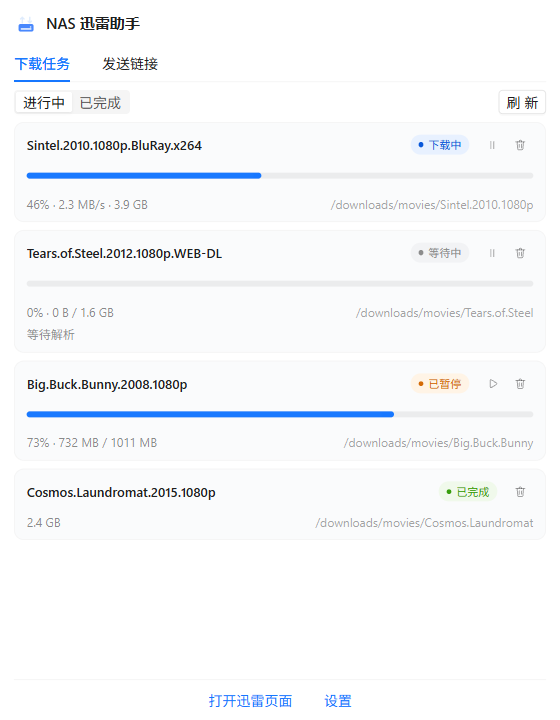
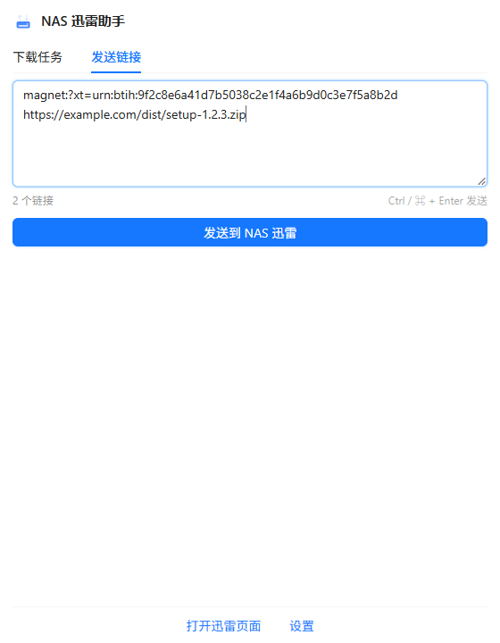
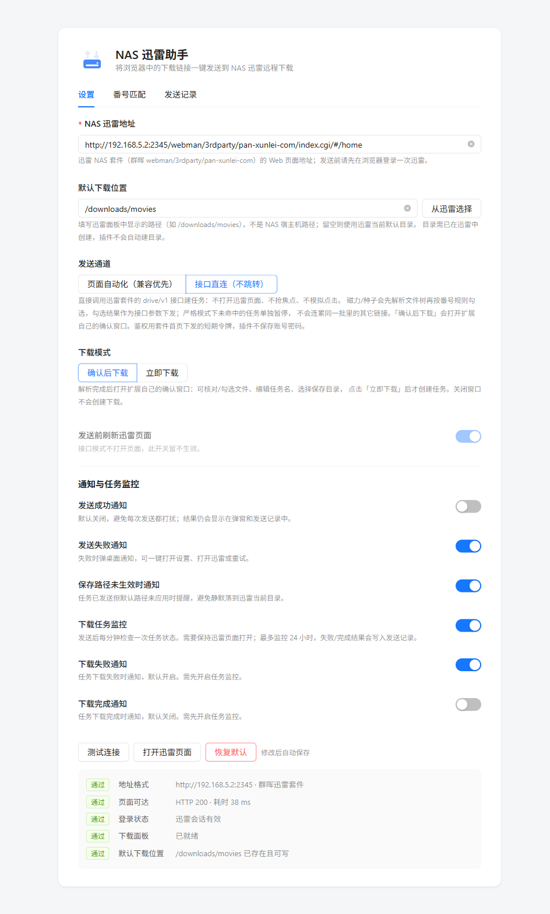
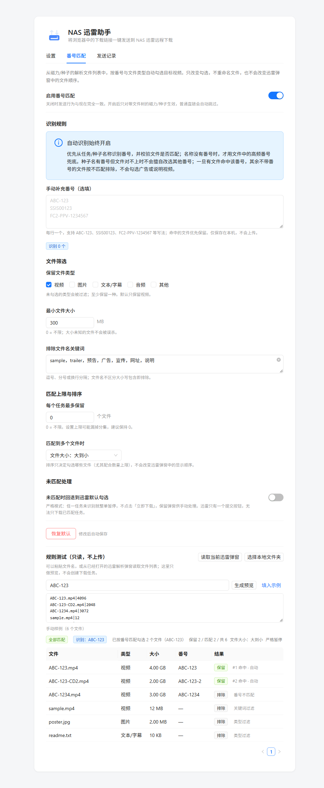
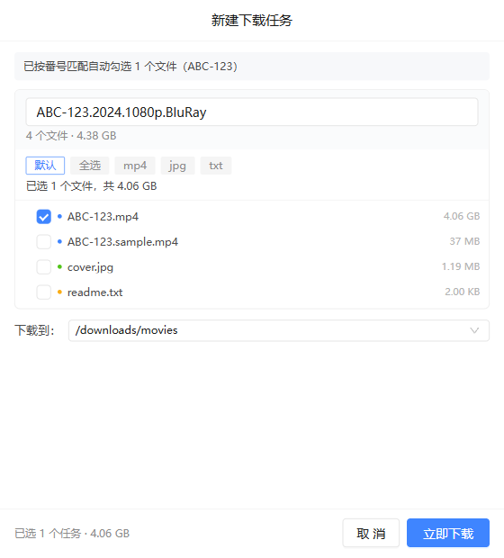
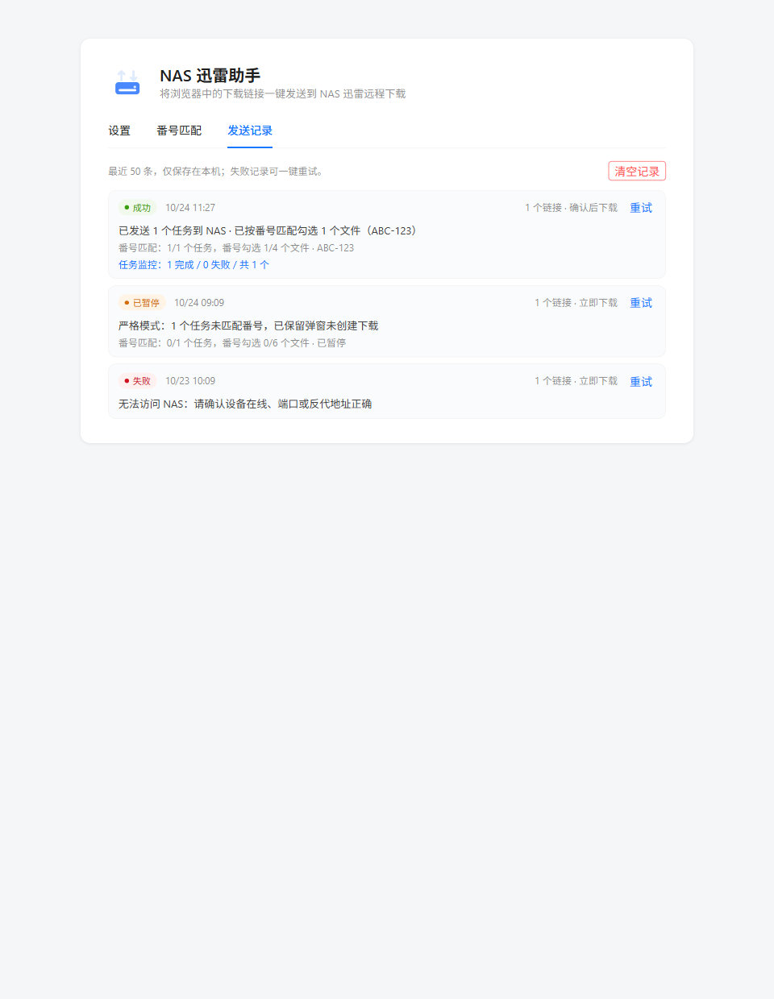

# NAS 迅雷助手

把下载链接（`thunder://`、`magnet:`、`ed2k:`、`http(s)://`）一键发送到 NAS 迅雷。

- 适配后端：[cnk3x/xunlei](https://github.com/cnk3x/xunlei)（群晖套件版 `pan-xunlei-com`）
- 灵感来源：[Soraika/nas-thunder-helper](https://github.com/Soraika/nas-thunder-helper)
- 技术栈：[WXT](https://wxt.dev) + [Vue 3](https://vuejs.org) + TypeScript + [Ant Design Vue](https://antdv.com)
- 项目地址：[github.com/moonlightMing/nas-xunlei-helper](https://github.com/moonlightMing/nas-xunlei-helper)

## 界面预览

**工具栏弹窗**——任务进度与暂停/继续/删除 · 多行粘贴、去重与协议校验

**控制面板**——地址与下载位置、发送通道与下载模式、通知与监控、测试连接

**番号匹配与确认窗口**——规则与只读预览 · 接口直连的确认下载

**发送记录**——最近 50 条，失败可重试

> 截图均为演示数据（示例地址 `192.168.5.2`、示例番号 `ABC-123`），不含真实信息，生成方式见[开发文档](docs/DEVELOPMENT.md#文档截图与脱敏)。

## 功能

### 发送通道与下载模式

| | 页面自动化（默认） | 接口直连 |
| --- | --- | --- |
| 方式 | 打开迅雷页面模拟点击 | 调用套件 `drive/v1` 接口，不打开页面、不抢焦点 |
| 番号匹配 | ✅ | ✅ 同一套规则；未命中只暂停单个链接 |
| 重复资源防呆 | 确认模式弹窗可人工核对；立即下载自动拦截 | 自动拦截，均可「仍然发送」覆盖 |
| 发送前刷新 | 可开关（默认开） | 不适用 |

- **确认后下载（默认）**：页面自动化停在迅雷确认框；接口直连打开自绘确认窗口（见上图），关闭不下载，30 分钟未确认失效
- **立即下载**：发送后自动解析并直接开始下载

### 控制面板

- NAS 地址（带校验）、默认下载位置（迅雷目录树选择，发送时自动预选；目录不可用时回退并通知）
- 测试连接：地址、可达、登录、面板、目录逐项诊断
- 通知开关：发送成功 / 失败、路径未生效、任务失败 / 完成
- 发送记录：最近 50 条，失败一键重试
- 番号匹配：按番号自动勾选目标视频，支持类型 / 大小 / 关键词 / 排序 / 每任务上限；严格模式未命中暂停，可切回退；规则预览只读本机文件名、不上传

### 发送入口

- 右键菜单：链接 / 选中文本 / 视频、音频元素，多个链接全部提取
- popup「发送链接」页：多行或空格分隔、自动去重、协议校验、Ctrl / ⌘ + Enter 发送
- 可操作通知：失败可打开设置 / 迅雷、可重试；点击通知直达迅雷页
- 任务监控：每分钟检查任务状态（页面自动化需迅雷页面保持打开，接口直连不依赖页面）

## 通知与任务监控

- 发送失败默认通知、成功默认不通知，可分别开关；路径未生效单独提醒
- 「已暂停」（未匹配 / 重复拦截）单独通知，不受失败开关控制；已创建的任务仍会进入监控
- 任务监控：失败默认通知、完成默认不通知；停止原因写入发送记录；两种发送通道都支持
- 只读复用迅雷面板状态与套件接口，不新增后端、不主动重开页面

## 权限说明

| 权限 | 用途 |
| --- | --- |
| `storage` | 设置、发送记录与监控状态（仅本机） |
| `contextMenus` | 右键菜单 |
| `tabs` | 查找、打开、聚焦迅雷页面 |
| `scripting` | 向迅雷页面注入自动化脚本 |
| `notifications` | 发送与任务结果通知 |
| `alarms` | 任务监控的每分钟检查 |
| `host_permissions` | NAS 地址由用户配置，放行 http/https |

## 环境要求

- Chrome / Edge / Cent Browser **5.x+**（Manifest V3；Cent 4.x 无法加载）
- NAS 运行 [cnk3x/xunlei](https://github.com/cnk3x/xunlei)，且浏览器已登录其 Web 页面
- 源码构建需 Node.js >= 22 与 pnpm，见[开发文档](docs/DEVELOPMENT.md)

## 安装

1. `pnpm build`
2. `chrome://extensions` 开启「开发者模式」
3. 「加载已解压的扩展程序」选择 `.output/chrome-mv3`
4. 设置页填入 NAS 迅雷地址
5. 打开一次迅雷页面并登录（插件复用已登录会话，不管理凭证）

`pnpm zip` 可打包分发；安装仅发生在本地浏览器，NAS 无需任何操作。开发调试见[开发文档](docs/DEVELOPMENT.md#调试部署)。

## 常见问题

发送失败时，通知与 popup 会给出原因：

| 提示 | 处理 |
| --- | --- |
| 地址未配置 / 不正确 | 到设置页修正地址 |
| 无法访问 NAS | 确认 NAS 在线、端口或反代地址正确 |
| 需要登录 | 打开迅雷页面登录后重试 |
| 面板未就绪 | 确认地址指向迅雷套件；套件升级后可能需适配选择器 |
| 解析失败 / 超时 | 确认链接有效 |
| 迅雷页面已关闭 | 重新发送 |

**番号匹配为什么整单暂停？**
严格模式下任一任务未识别或文件树未就绪就不会点「立即下载」，避免误下广告。手动检查勾选或放宽规则后重试；接口直连只暂停未命中的链接。

**排序为什么不改变迅雷界面？**
迅雷弹窗不支持排序；插件排序只决定保留哪些文件（配合每任务上限）。

**直链没有走番号匹配？**
预期行为：番号匹配只作用于磁力 / 种子解析出的 BT 文件树。

**「已阻止重复发送」？**
NAS 上已有同一资源的任务。重发会顶掉已解析完成的旧任务记录（文件不丢，但旧任务消失、新任务落 `名称(1)` 目录）。确实要重发点「仍然发送」。

**任务监控没有完成通知？**
完成通知默认关闭；页面自动化通道还需保持迅雷页面打开。结果也会写入发送记录。

**重试提示记录过期？**
重试依赖 30 分钟内的发送记录，过期后重新粘贴发送。

开发与调试问题见[开发文档](docs/DEVELOPMENT.md#开发排障)。

## 已知限制

- 下载位置只支持已存在目录，不可用时回退迅雷当前目录并通知
- 任务监控需保持迅雷页面打开（最长 24 小时）；接口直连无页面监控，下载状态看 popup「下载任务」页
- 番号匹配只处理 BT 文件树，排序不重排迅雷界面，每任务上限可能漏分集
- 强依赖迅雷页面结构与套件 `drive/v1` 接口（实测 v3.23.5），迅雷升级后可能失效，会明确报错并提示切回
- 点击步骤不自动重试；通知按钮 / 常驻尽力而为，完整信息始终在 popup 与发送记录
- 手动番号 / 关键词与发送记录仅存本机，可清空

## 开源协议

[MIT License](LICENSE)。欢迎提交 Issue 或 PR。

## 相关文档

- [开发文档](docs/DEVELOPMENT.md)：工作原理、构建、调试部署与测试清单
- [CHANGELOG.md](CHANGELOG.md)：更新日志
- [AGENTS.md](AGENTS.md)：代码约定与实现约束
