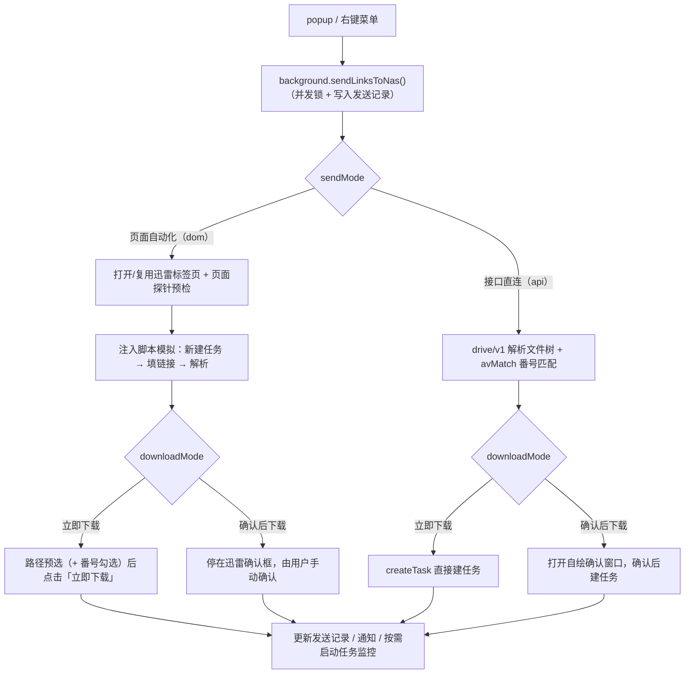

# 开发文档

面向开发者与贡献者。安装与使用说明见 [README](../README.md)，修改代码前请先阅读 [AGENTS.md](../AGENTS.md) 中的实现约束与验证要求。

## 开发环境

- Node.js **>= 22**（WXT 0.21 要求）与 pnpm
- 支持 Manifest V3 的浏览器：
  - Google Chrome / Microsoft Edge
  - Cent Browser（百分浏览器）**5.x 及以上**（Chromium 118/132 内核）；4.x（Chromium 80）无法加载

## 常用命令

| 命令 | 说明 |
| --- | --- |
| `pnpm install` | 安装依赖（postinstall 自动执行 `wxt prepare`） |
| `pnpm dev` | 开发模式：启动 WXT 开发服务器并打开浏览器，支持热更新 |
| `pnpm compile` | 类型检查（`vue-tsc --noEmit`） |
| `pnpm build` | 生产构建，产物输出到 `.output/chrome-mv3` |
| `pnpm check` | `compile` + `build`，提交前至少执行一次 |
| `pnpm zip` | 构建并打包为 `.output/nas-xunlei-helper-<version>-chrome.zip` |
| `pnpm deploy` | 构建并部署到 Chrome 调试实例（见下） |
| `pnpm deploy:cent` | 构建并部署到 Cent Browser 调试实例（见下） |

> 构建时可能出现 chunk 超过 500 kB 的警告（Ant Design Vue 全量引入，尚未做按需拆分），不影响功能。

## 项目结构

```text
entrypoints/
  background.ts          # 右键菜单、消息路由、发送编排、通知动作、任务监控 alarm
  options/               # 控制面板（设置、番号匹配、测试连接、目录树、发送记录）
    components/          # 番号匹配配置表单与只读规则预览
  popup/                 # 工具栏弹窗：下载任务页 + 发送链接页
    components/          # TasksPanel 任务列表与控制、SendPanel 粘贴发送
  confirm/               # 接口直连「确认后下载」窗口（仿迅雷文件树、目录选择）
utils/
  settings.ts            # 设置的读写、校验与跨上下文同步（含 avMatch）
  avMatch.ts             # 番号识别/归一化、类型分类、匹配计划、摘要
  confirm.ts             # 确认窗口的待确认状态（storage.session）、文件树与建任务参数
  links.ts               # 链接提取、去重、协议校验
  sendErrors.ts          # 错误码、用户提示与重试策略
  messaging.ts           # 扩展内消息与响应类型
  xunleiTab.ts           # 迅雷标签页查找、打开、聚焦与加载等待
  xunleiAutomation.ts    # 注入迅雷页面的 DOM 自动化、探针、目录与任务读取（页面自动化通道）
  xunleiApi.ts           # drive/v1 接口客户端：令牌、解析、建任务、目录与任务读写（接口直连通道）
  history.ts             # 发送记录
  notifications.ts       # 桌面通知与通知按钮动作
  taskMonitor.ts         # 下载任务监控 alarm 与状态比对
scripts/
  deploy.mjs             # 本地一键构建并部署到调试浏览器
public/icons/            # 扩展图标（16/48/128）
wxt.config.ts            # 扩展清单与构建配置
```

## 工作原理



**页面自动化（默认）**——复用已登录的迅雷 Web 会话，注入脚本模拟「新建任务 → 填链接 → 解析 → 立即下载」：

- 保存路径：读取迅雷页面 Vuex 解析出目录 ID 后预选，交给面板原生建任务流程，不自行拼接请求
- 路径填迅雷面板显示的路径（如 `/downloads/movies`），目录需已存在；不可用时回退迅雷当前目录并在通知中说明
- 番号匹配：只读拍平 BT 文件树 → 本机算计划 → 调面板树组件 `setCheckedKeys` 应用勾选；不重排界面
- 番号识别支持标准番号、FC2、Tokyo Hot、无码日期码、分集 / 字幕后缀；根名番号只在零命中时兜底继承
- 严格模式多任务任一未识别整单暂停（迅雷只有一个「立即下载」按钮）；直链跳过匹配
- DOM 选择器集中在 [utils/xunleiAutomation.ts](../utils/xunleiAutomation.ts)

**接口直连**——不打开页面，直接调用套件 `drive/v1` 接口：

- 流程：`resource/list` 解析文件树 → 同一套 `avMatch` 纯函数决定保留文件 → 序号编码为 `sub_file_index`（如 `"0"`、`"0-1,3"`）随 `createTask` 下发
- 每个链接独立任务，未匹配只暂停自己，不连累同批其它链接
- 鉴权用套件首页下发的短期令牌（约 3 天），仅内存 / 会话缓存，不保存账号密码；取不到令牌时明确报错并提示切回页面自动化
- 「确认后下载」：解析结果写入 `storage.session` 后打开 [entrypoints/confirm](../entrypoints/confirm/) 自绘确认窗口
  - 窗口不持有令牌，提交只回传文件 id，由后台重新校验编码后建任务
  - 关闭或 30 分钟未确认按取消写回记录；文件树超解析上限只能整包

> 本仓库只有浏览器扩展，没有 NAS 端组件或后端服务；NAS 侧只需运行 [cnk3x/xunlei](https://github.com/cnk3x/xunlei)。

## 调试部署

`scripts/deploy.mjs` 会完成「构建 → 复用或启动独立调试实例 → 重载扩展」的全流程。

| 目标浏览器 | 命令 | 调试端口 | 独立 profile |
| --- | --- | --- | --- |
| Google Chrome | `pnpm deploy` | 9223 | `.debug-profile` |
| Cent Browser | `pnpm deploy:cent` | 9224 | `.debug-profile-cent` |
| Microsoft Edge | `node scripts/deploy.mjs --browser=edge` | 9225 | `.debug-profile-edge` |

不同目标的端口与 profile 相互独立，可同时部署、共存；调试实例与日常浏览器互不影响。

### 执行步骤

1. 安装依赖：`pnpm install`
2. （可选）先做类型检查和构建：`pnpm check`
3. 执行上表对应命令。脚本会再构建一次，因此无需提前 `pnpm build`
4. **首次部署**：扩展列表没有「NAS 迅雷助手」时，在自动打开的 `chrome://extensions` 手动加载一次（开发者模式 → 加载已解压的扩展程序 → `.output/chrome-mv3`）；之后同 profile 部署全自动
5. 在扩展设置页填入 NAS 迅雷地址，并在调试实例中打开迅雷页面登录一次
6. 右键任意链接或在 popup 中发送，按[手动测试清单](#手动测试清单)验收

### 脚本做了什么

1. 执行 `pnpm build`，确认 `.output/chrome-mv3/manifest.json` 存在
2. 探测目标端口的 CDP：已有调试实例则复用，否则独立 `--user-data-dir` 启动并等待就绪
3. 经 `chrome://extensions` 的 `chrome.developerPrivate.reload()` 重载扩展
4. 回退（找不到扩展或重载失败）：关调试实例 → 清 Service Worker 脚本缓存 → 带 `--load-extension` 重启。回退仅对支持该参数的浏览器（Chrome for Testing、Cent 5.x）等效；Chrome 137+ 正式版仍需手动加载

### 环境变量

- `XUNLEI_DEBUG_PORT`：覆盖调试端口，例如 `XUNLEI_DEBUG_PORT=9333 pnpm deploy`
- `XUNLEI_DEBUG_BROWSER`：指定浏览器可执行文件路径，跳过自动探测

PowerShell 中设置方式为 `$env:XUNLEI_DEBUG_PORT=9333; pnpm deploy`。

### 注意事项

- **Chrome 137+ 正式版忽略 `--load-extension`**：首次需手动加载（见上文）。项目根目录存在 Chrome for Testing（`chrome/win64-<version>/chrome-win64/chrome.exe`，已 git 忽略）时优先使用，可自动挂载；也可用 `XUNLEI_DEBUG_BROWSER` 指定其它构建
- **Cent Browser 5.x**（已适配 5.2.1168.83 / Chromium 132）无此限制，首次通常自动挂载；便携路径 `D:\Software\CentBrowser\Application\chrome.exe` 可自动探测，其它位置设 `XUNLEI_DEBUG_BROWSER`
- 调试 profile 是项目内独立目录且已被 git 忽略，不污染日常浏览器，也不要提交
- 部署后行为仍是旧版本时，见[开发排障](#开发排障)

## 开发排障

**部署脚本提示未找到浏览器**
设置 `XUNLEI_DEBUG_BROWSER` 指向浏览器主程序（如 `...\Application\chrome.exe`）后重试。

**调试端口等待超时**
先访问 `http://127.0.0.1:<端口>/json/version` 检查；关闭遗留调试实例，或 `XUNLEI_DEBUG_PORT` 换端口。

**调试实例里没有本扩展，或部署后仍是旧行为**
- 首次：按「执行步骤」第 4 步手动加载 `.output/chrome-mv3`
- 旧行为：Chromium 按 profile 缓存扩展 SW 字节码。完全退出调试浏览器 → 删 profile 下 `Default/Service Worker/ScriptCache` → 重新部署（`.debug-profile` / `.debug-profile-cent` / `.debug-profile-edge`）

## 文档截图与脱敏

[README「界面预览」](../README.md#界面预览) 的截图（[docs/images](images/)）不含真实数据：

- 生成方式：CDP 注入拦截层，把存储读取与消息响应替换为演示数据后再截图，页面渲染出的内容全部虚构，无需事后打码
- 占位约定：地址 `http://192.168.5.2:2345/...`、路径 `/downloads/movies`、番号 `ABC-123`、任务名用 Blender 等公开电影
- 必须展示真实界面的截图：敏感区域（IP / 文件名 / 番号 / 令牌）入库前先涂码，并在提交说明中注明
- 截图脚本为仓库外一次性工具，不入 git；更新时先 `pnpm build`，用最新产物重截

## 手动测试清单

需要真实 NAS 环境验证；任务监控部分建议准备一条可快速完成的小文件链接，以及一条会失败的链接。

**基础与发送**

- [ ] 设置页：空地址/非 http(s) 地址保存时有警告；合法地址保存成功
- [ ] 设置页：「打开迅雷页面」能打开/聚焦所配地址
- [ ] 未配置地址时：右键菜单/popup 发送有明确提示
- [ ] 立即下载模式：右键发送一个磁力链接 → 任务出现在 NAS，默认只弹失败通知、不弹成功通知
- [ ] 确认后下载模式：右键发送 → 迅雷页面停在确认框，可编辑文件名/路径后手动确认
- [ ] 浏览器缩放 150%/200%：popup 无横向滚动条；接口模式确认窗口自动放大到接近设计宽度
- [ ] 默认下载位置：配置一个已存在且可写的目录（如 `/downloads/02`）→ 立即下载 → 通知/记录显示保存路径，迅雷任务详情一致
- [ ] 默认下载位置：配置不存在的目录 → 通知说明原因，任务仍按迅雷当前目录下载
- [ ] 确认后下载模式：路径已预选在迅雷确认框中，仍可手动改路径
- [ ] popup 多行/空格分隔链接、重复链接、非链接文本、超过 50 个链接时的计数与提示
- [ ] popup Ctrl / ⌘ + Enter 发送
- [ ] 右键选中文本（含多个链接）、视频/音频元素、无链接选区
- [ ] popup 与右键同时发送：第二个提示“正在发送中”，不重复建任务
- [ ] 关闭「发送前刷新」且迅雷页有残留结果框时，发送被拦截并提示先处理

**诊断与通知**

- [ ] 设置页「测试连接」：正确地址全部通过；错误地址/离线地址、未登录、非迅雷页面分别给出对应原因
- [ ] 设置页「从迅雷选择」：根目录加载、展开子目录、选择路径后自动保存
- [ ] 发送失败通知：按钮「打开设置/打开迅雷」「重试」可用；点击通知正文能直达对应页面
- [ ] 成功通知开关：默认关闭；开启后发送成功会弹通知
- [ ] 路径未生效通知：配置不可写/不存在的目录时触发，可打开设置或迅雷
- [ ] 通知重试：停止 Service Worker 后点击「重试」仍可用；超过 30 分钟后提示记录过期
- [ ] 发送记录：显示时间、链接数、模式、消息、监控摘要；失败可重试；可清空
- [ ] 首次安装/清空地址后打开设置页能看到三步引导

**番号匹配**

- [ ] 配置页：自动识别/手动补充/类型/大小/关键词/上限/排序保存后重载一致；恢复默认只重置番号匹配
- [ ] 规则预览：默认示例中 ABC-123 命中、ABC-1234 不命中、sample/图片/文本排除；粘贴文件名和选择本地文件夹（如 `Z:\xfmovie`）只读预览
- [ ] 只读读取当前迅雷弹窗：解析磁力后能读到任务/文件/大小/勾选状态；无弹窗有提示；不创建任务
- [ ] 确认后下载 + 自动识别：目标正片被勾选，sample/图片/文本不勾选，停在弹窗不自动点击
- [ ] 立即下载 + 全部匹配：只点击一次，任务创建成功
- [ ] 严格未匹配：普通非番号磁力不点击、弹窗保留、通知「已暂停」、记录状态「已暂停」、不启动监控
- [ ] 回退模式：未匹配任务保留原勾选并继续，记录/消息标注回退
- [ ] 类型/大小/关键词/每任务上限 + 排序实际生效；多任务部分未匹配时严格整单暂停
- [ ] 非 BT 直链跳过匹配正常发送；关闭总开关后行为与旧版一致
- [ ] 迅雷组件能力异常/文件树超时：严格暂停不点击，回退按原勾选继续

**接口直连通道（含番号匹配）**

- [ ] 切到「接口直连」后发送磁力：迅雷页面**不打开、不抢焦点**，任务出现在 popup 任务页
- [ ] 立即下载 + 番号匹配：只有目标正片被下载，`sub_file_index` 与页面自动化结果一致（可用 NAS 上任务的详情核对）
- [ ] 严格未匹配：该链接不建任务、通知「已暂停」，**同批其它已匹配链接仍正常创建**
- [ ] 回退模式：未匹配链接整包下发（不传 `sub_file_index`），记录/消息标注
- [ ] 手动番号 / 类型 / 大小 / 关键词 / 上限 + 排序：与页面自动化模式给出相同选择
- [ ] 分集/文件夹包：中间层目录名带番号时按整体保留，得到 `"0-1"` 这类连续段
- [ ] 保存路径：配置的路径解析成 NAS 目录；路径不存在时回退迅雷默认目录并如实提示
- [ ] 非 BT 直链跳过匹配正常发送；关闭番号匹配总开关后整包下发
- [ ] 令牌过期/迅雷升级取不到令牌：明确报错并提示切回页面自动化，不静默失败
- [ ] popup 任务页：进度/速度实时刷新，暂停、继续、删除（含二次确认）生效
- [ ] 确认后下载：发送磁力 → 打开扩展确认窗口，文件树/预选/任务名/保存目录正确；关闭窗口不建任务，记录为「已暂停」；右键菜单发送同样会打开窗口
- [ ] 确认后下载 + 严格未匹配：默认不勾选、给出原因，可手动勾选后提交；文件树超限时只能整包下载
- [ ] 确认后下载：点击「立即下载」后任务出现在 NAS，`sub_file_index` 与窗口勾选一致（会创建真实任务，需先取得批准）

**任务监控**

- [ ] 立即下载：发送小文件 → 记录出现“监控中” → 完成后记录更新；完成通知默认不弹
- [ ] 下载失败链接：任务进入 ERROR → 失败通知包含任务名，记录失败数更新
- [ ] 开启“下载完成通知”后，完成任务会弹通知
- [ ] 批量 3-5 个链接：同一轮扫描的失败/完成合并成一条通知，不刷屏
- [ ] 确认后下载：发送后等待 2 分钟再点「立即下载」→ 监控仍能发现并跟踪任务
- [ ] 监控中关闭迅雷页面：约 3 分钟后记录显示“监控停止：迅雷页面已关闭”，不弹失败通知
- [ ] 关闭「下载任务监控」后，发送不再产生监控记录/任务通知

## 相关文档

- [README](../README.md)：安装与使用说明
- [AGENTS.md](../AGENTS.md)：代码约定、实现约束与验证要求
- [CHANGELOG.md](../CHANGELOG.md)：更新日志
